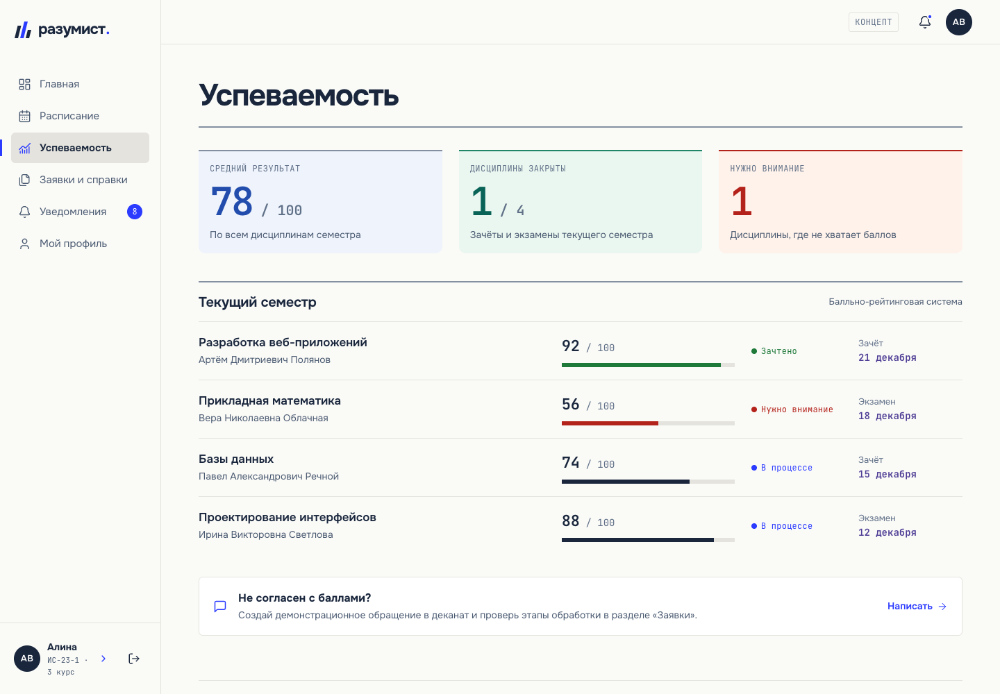
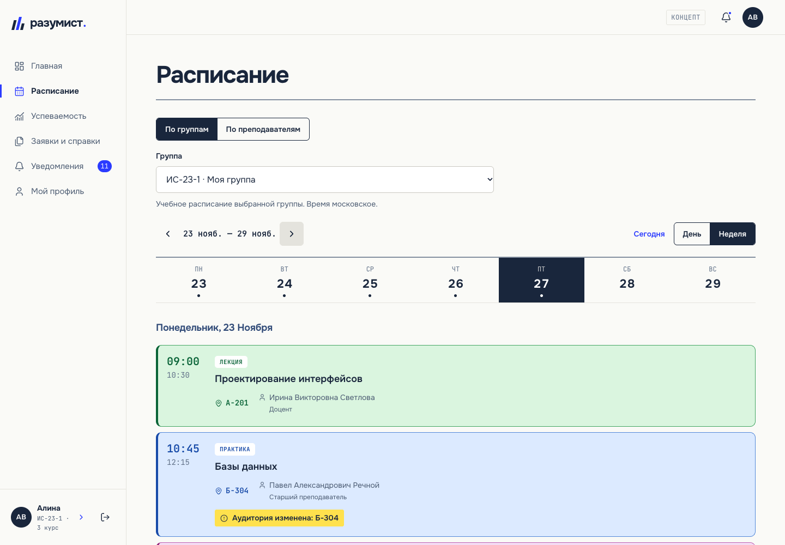
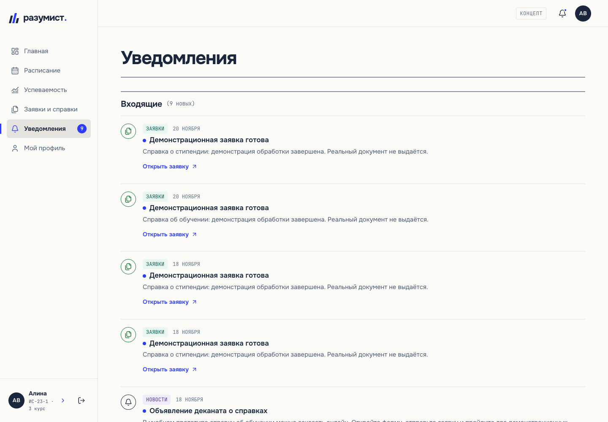
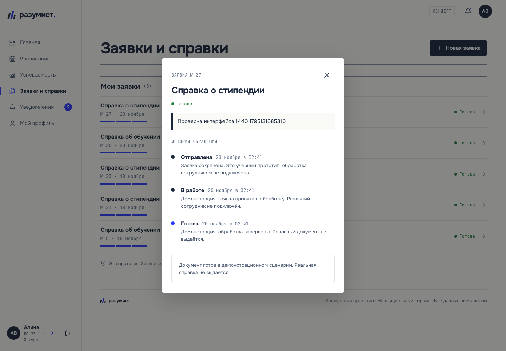
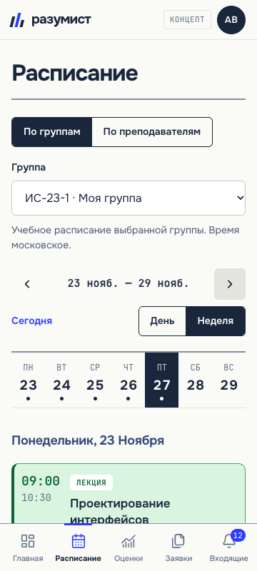
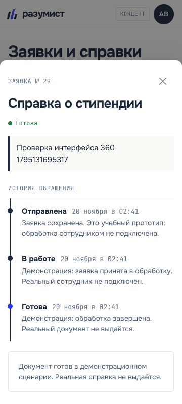
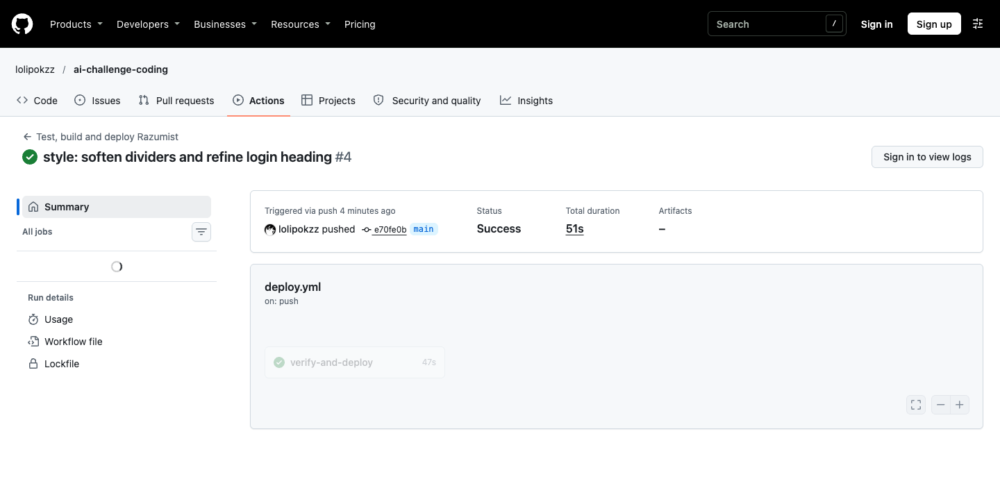
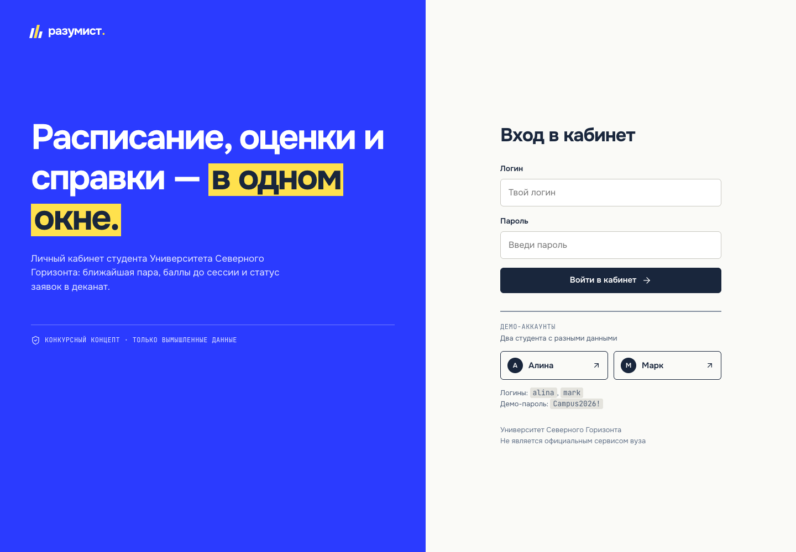
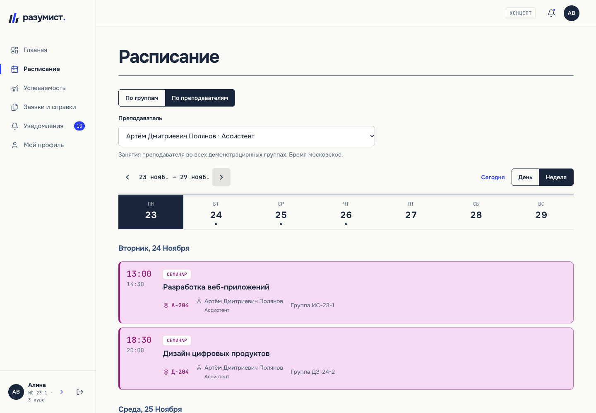

# Отчёт о создании
проекта Разумист

Личный кабинет студента на Go и React

Разработка 6–7 ноября 2026 года
Публикация 18 ноября и повторная проверка 20 ноября 2026 года

Разумист объединяет расписание, успеваемость, заявки и объявления в одном кабинете. В опубликованном прототипе можно войти под двумя вымышленными студентами, увидеть разные учебные данные, подать обращение и проверить его статус.

Документ показывает, как проект создавался с ИИ-ассистентами: от постановки задачи и распределения ролей до работающего интерфейса и проверок безопасности. С 18 ноября кабинет доступен по HTTPS; настроены автоматические проверки и обновление сервера.

[Открыть кабинет https://176.98.179.224](https://176.98.179.224)

[Исходный код на GitHub](https://github.com/lolipokzz/ai-challenge-coding)

Рисунок 1. Актуальная главная страница: учебная сводка и блок «Что требует внимания». Снимок опубликованной версии от 20 ноября 2026 года.

## Проблема студентов и разделы кабинета

Учебная информация часто распределена между сайтом, отдельной системой оценок, чатами и деканатом. Студент тратит время на поиск нужного канала и не всегда понимает, изменилось ли расписание и что происходит с его заявкой.

Разделы выбраны по обязательным сценариям ТЗ. Опрос однокурсников не проводился; гипотезы о пользе сервиса ещё предстоит проверить с реальными пользователями.

| Раздел | Задача студента |
| --- | --- |
| Вход и профиль | Войти в свой кабинет и увидеть факультет, направление, курс и группу. |
| Расписание | Посмотреть занятия дня и недели, аудиторию, преподавателя и переносы. |
| Успеваемость | Сопоставить баллы, зачёты и даты сессии; заметить дисциплины, требующие внимания. |
| Заявки и справки | Отправить обращение, просмотреть историю и статус, отменить заявку. |
| Уведомления | Узнать об изменениях, объявлениях, точных сроках и готовности демонстрационной заявки. |

Рисунок 2. Успеваемость: средний результат, закрытые дисциплины, текущие баллы и даты аттестаций.

## Расписание выбранной недели

Расписание открывает выбранный день или неделю. При переходе на другую неделю интерфейс запрашивает её у сервера; даты рассчитываются для Москвы. Занятия показывают время, аудиторию, преподавателя и заметное изменение. Лекции выделены зелёным, практики синим, семинары насыщенным фиолетовым; текстовые названия сохраняются. Обзор использует текущую и следующую недели, чтобы не терять ближайшее занятие на выходных.

Рисунок 3. Расписание выбранной недели после исправления навигации. Снимок опубликованной версии от 20 ноября 2026 года.

Раньше переключение даты не меняло серверную выборку: за пределами текущей недели пользователь видел пустой экран. Теперь дата недели передаётся в API, сервер нормализует её до понедельника и возвращает соответствующие занятия.

## Объявления и конкретные сроки

В уведомлениях есть объявления и дедлайны с точными датами. Действие из уведомления ведёт к нужному разделу или форме; важные события собраны также на главной. Данные являются демонстрационными и не отражают расписание реального вуза.

Рисунок 4. Уведомления в актуальном интерфейсе: объявления, сроки и переходы к действиям. Снимок опубликованной версии от 20 ноября 2026 года.

Отметка прочтения сохраняется на сервере отдельно для каждого студента. Добавление новых демонстрационных событий не должно сбрасывать уже существующие отметки или пользовательские заявки.

## Сценарий обращения в деканат

Основной сквозной сценарий — от заказа справки до проверки сохранённой заявки. Интерфейс обращается к серверу Go, а запись хранится в SQLite и остаётся доступной после обновления страницы.

### Выбор услуги

Студент открывает форму и выбирает справку об обучении, справку о стипендии, материальную помощь или обращение в деканат.

### Отправка

Можно добавить комментарий. Сервер проверяет вход, CSRF-токен, тип обращения и допустимую длину текста.

### Демонстрация обработки

Новая запись получает статус «Отправлена». В карточке есть номер, комментарий, история и отмена. Явно помеченное демо-действие последовательно переводит её в обработку и готовность.

Рисунок 5. Заявка после демонстрации обработки: статус и сохранённая история переходов.

Реальная обработка сотрудником не подключена. Статусы меняются только по явному демо-действию владельца, а не автоматически по таймеру. При готовности появляется уведомление. Настоящая справка не выдаётся.

## Работа кабинета на телефоне

На узком экране разделы доступны через нижнюю панель навигации, карточки перестраиваются. Снимки ниже показывают актуальный интерфейс при ширине 360 px; результаты повторного прогона приведены в разделе проверок.

Рисунки 6 и 7. Расписание и заявка в актуальном интерфейсе при ширине 360 px. Снимки опубликованной версии от 20 ноября 2026 года.

Для диалогов добавлены подписи полей, закрытие по Escape, удержание и возврат фокуса. Проверка на физическом телефоне и полный аудит доступности не проводились.

## ИИ инструменты и распределение работы

Основным ИИ-инструментом был Codex. Один ассистент работал как тимлид, три субагента выполняли ограниченные задачи в общем каталоге. Это роли внутри Codex, а не четыре разных ИИ-сервиса.

| Инструмент | Как использован |
| --- | --- |
| Codex | Анализ ТЗ, архитектура, код, тексты интерфейса, документация и интеграция. |
| Субагенты Codex | Первый цикл: backend, frontend, qa_report. Исправления: fix_backend, fix_frontend, update_report. Тимлид интегрирует и проверяет результат. |
| Навык Sites | Локальная стадия разработки. Хостинг Sites не использовался; приложение опубликовано на отдельном VPS. |
| CUA, Playwright и Chrome | CUA — первоначальная проверка 6–7 ноября. Playwright и Chrome 157 — повторные сценарии и скриншоты 17–18 ноября; Chrome также использован для настройки GitHub. |
| Shell Git и GitHub | Файлы, тесты, история кода и удалённый репозиторий. GitHub Actions запускает проверки, сборку и публикацию. |
| Go и SQLite | HTTP API, сессии, контроль доступа и сохранение данных. |
| React и Vite | Интерфейс и клиентская сборка; Node.js, pnpm и npm — окружение и зависимости. |
| Python unittest и urllib | Интеграционные тесты настоящего HTTP API с временной базой. |
| Lucide, Onest, JetBrains Mono | Иконки и локальные шрифты. Лицензии ISC и SIL OFL 1.1 сохранены; обращения к шрифтовым CDN не нужны. |
| Prettier | Приведение исходников интерфейса к читаемому формату. |
| Навык Documents и python-docx | Подготовка этого документа; LibreOffice и PNG-рендер — проверка его оформления. |

### Как агенты согласовывали результат

Тимлид зафиксировал правила в AGENTS.md, маршруты и форматы данных в docs/API.md. Backend отвечал за main.go и зависимости Go, frontend — за src и клиентскую конфигурацию, QA — за tests и отчёт. Такой раздел файлов позволил работать параллельно и затем собрать единый проект.

ИИ использовался и для дизайна: визуальное направление было задано текстовым промптом и реализовано кодом. Генерация изображений, Figma, внешние ИИ API и официальные логотипы вузов в этом этапе не применялись.

## Этапы от идеи до работающего кабинета

### 1 Постановка задачи

Пользователь передал конкурсное ТЗ, поручил ассистенту роль тимлида, попросил распределить задачи субагентам, начать отчёт и не выполнять деплой. Приоритетом стали пять обязательных разделов, два аккаунта и мобильная версия.

### 2 Уточнение продукта и стека

Первое предложение — React, Node.js и SQLite. Из-за отсутствия Node в PATH началась промежуточная версия на Python. После уточнения пользователя окончательно выбраны Go + React и название «Разумист». Позже Go и Node нашлись вне PATH; Python-сервер был удалён.

### 3 Контракт и параллельная разработка

Созданы общие инструкции, API-контракт и критерии приёмки. Серверный агент реализовал вход и данные, интерфейсный — экраны и адаптивность, QA-агент — внешние HTTP-проверки и описание процесса.

### 4 Интерфейс сразу в коде

Отдельный макет в графическом редакторе не создавался. Первый вариант получил собственный знак и тёмно-зелёную навигацию. В текущей версии — светлый фон, тёмно-синяя типографика, цветовые акценты по смыслу и локальные шрифты Onest и JetBrains Mono. Предусмотрены загрузка, ошибки и пустые списки. По просьбе пользователя имя внизу боковой панели открывает профиль; цвет помогает различать виды занятий и сводки.

### 5 Интеграция и исправление ошибок

При ревью исправлена потенциальная блокировка повторного входа. Тесты выявили взаимодействие лимита входов с успешными авторизациями: сценарии изолировали, а счётчик стал сбрасываться после успешного входа для пары IP и логина. Добавлены проверки ротации сессии и лимита.

### 6 Сборка и браузерная приёмка

Конфликт кэшей pnpm потребовал повторной установки пакетов. Встроенный Node не загрузил Rollup из-за подписи macOS; сборка прошла с официальным Node.js. Затем проверены оба аккаунта, создание и отмена заявок, сохранение данных, уведомления и мобильные экраны.

В истории сохранены реальные технические итерации. Неудачные визуальные макеты не создавались и не реконструировались задним числом. Скриншоты в документе показывают проверенный интерфейс, а не эскизы.

## Ключевые промпты и решения

Ниже приведены фрагменты фактических сообщений. Многоточие обозначает сокращение. Более подробный журнал находится в docs/PROMPTS.md.

### Пользователь задаёт роль и границы

«ты в роли тим лида декомпозируй это тз для своих суб агентов, чтобы выполнить его и сделать отчет пока никуда не деплой, просто сделай рабочий проект, начни делать отчет»

Результат — распределение задач, локальная разработка и документация без публикации.

### Пользователь уточняет технологию

«стек golang + react, название: разумист»

Результат — смена промежуточной реализации и сохранение согласованного API.

### Тимлид задаёт требования серверному агенту

«Реальный cookie auth PBKDF2, CSRF, ownership, безопасная раздача static, rate limit login, logout, persistent db … Два демо аккаунта, разные данные, заявки создание/отмена/история (не симулируй реальную обработку автоматически).»

Требования сохранены при переходе на Go: данные привязаны к сессии, заявки не получают фиктивную автоматическую обработку.

### Тимлид задаёт сценарии интерфейса

«Вход два демо аккаунта, главная с ближайшей парой/сводкой/уведомлениями/быстрыми действиями; расписание день/неделя с датами и изменениями, оценки с прогрессом и сессией, заявки форма+история+отмена+статусы … Мобильный 360 px полноценный, accessible labels, error/loading/empty»

Результат — связанный набор экранов и адаптивная версия с состояниями ошибок и загрузки.

### Тимлид поручает тестирование и отчёт

«meaningful тесты входа, двух аккаунтов, изоляции заявок, CSRF, logout, сохранения данных, ошибок … Отчёт русский честный черновик с фактическими промптами/распределением ролей, критериями и планом скриншотов, без выдумки завершённых проверок»

На ревью дополнительно потребованы русские категории уведомлений, честный текст о демонстрационных заявках, клавиатурная работа диалогов и сброс окон при смене аккаунта. Прогресс-бары заменены на native progress, совместимый со строгой CSP.

## Реальные итерации ИИ выбор стека и расписание

Ниже шесть эпизодов нашей работы. В кавычках — фактические фрагменты сообщений или вывода инструмента; многоточие означает сокращение. Описание причин и результатов — разбор команды, а не дословный ответ модели. Ранние эпизоды сверены с журналом docs/PROMPTS.md, последние — с перепиской и проверками 20 ноября.

### 1 Ошибочное предположение об окружении

«стек golang + react, название: разумист»

Недочёт ИИ. Ассистент не нашёл Node.js в PATH и начал промежуточную реализацию на Python. Отсутствие команды в PATH было ошибочно принято за отсутствие установленного инструмента; первоначальный выбор стека не совпадал с последним требованием пользователя.

Коррекция тимлида субагенту QA, фрагмент из журнала:

«ВАЖНО пользователь выбрал Go + React, название “Разумист” (именно последнее). Обнови отчёт/декомпозицию. Backend переписывается Go, контракт сохраняется.»

Исправление и результат. Go и Node найдены вне PATH, сервер переписан на Go, интерфейс собран на React; внешние API-тесты остались на Python. Подтверждение — main.go, package.json и успешная сборка в CI/CD. Вывод: сначала проверять окружение и последние уточнения человека, затем менять архитектуру.

### 2 Переключатель недель без соответствующей выборки

Недочёт реализации. Первоначальное переключение даты не меняло серверную выборку расписания: соседние недели могли оказаться пустыми. Наличие кнопок ещё не означало завершённый сценарий.

Тимлид → серверный агент, фрагмент фактического задания:

«GET schedule поддержка week=YYYY-MM-DD нормализовать понедельник MSK, валидация … миграция seed для существующих демо DB без сброса пользовательских записей»

Исправление и результат. API принимает выбранную неделю, клиент загружает её и обрабатывает загрузку, ошибку и устаревшие ответы. Проверка test_schedule_week_validation_and_normalization и браузерный переход на следующую неделю прошли; 20 ноября сценарий повторён на опубликованной версии при 1440 и 360 px.

## Реальные итерации ИИ проверки и полнота профиля

### 3 Тесты влияли друг на друга через лимит входа

Исходная постановка тимлида QA, фрагмент:

«meaningful тесты входа, двух аккаунтов, изоляции заявок, CSRF, logout, сохранения данных, ошибок»

Ошибка тестовой организации. По журналу проекта первый общий прогон упёрся в ограничение частоты входов. Сценарии использовали общий счётчик попыток: результат зависел от предыдущих тестов. Этот сбой нельзя описывать как доказанный отказ входа для обычного пользователя.

Исправление. Перед каждым сценарием запускается новый процесс сервера, при этом временная SQLite сохраняется. Успешный вход сбрасывает счётчик соответствующей пары IP и логина. Сообщение серверного агента из журнала:

«Rate limit 10 попыток/мин на IP + логин; успешный вход сбрасывает счётчик именно этой пары»

Подтверждение. В tests/test_api.py есть setUp, отдельный test_login_rate_limit и проверка сохранения после перезапуска. Ранний результат — 12 успешных тестов; повторный прогон 20 ноября — 17. Исходный полный лог первого сбоя не приложен, поэтому точный текст ошибки не реконструируется.

### 4 Пропущено отчество в требовании ФИО

Недочёт реализации ИИ. В профилях были только имя и фамилия. При сверке с буквальным требованием «ФИО» это отмечено как незакрытый пункт; пользователь дал конкретное уточнение:

«добавь отчества везде»

Исправление. Добавлены вымышленные отчества двум студентам и четырём преподавателям. Миграция обновляет известные старые имена в существующей SQLite; остальные поля, заявки и уведомления сохраняются. Инициалы аватара берутся из имени и фамилии.

Подтверждение. test_patronymic_migration_preserves_existing_data дважды запускает миграцию, сверяет сохранённые записи и проверяет запрет доступа к чужой заявке. Коммит 581808f опубликован; полные имена проверены на сервере 20 ноября. Вывод: проверять не только наличие раздела, но и каждое поле ТЗ.

## Реальные итерации ИИ автоматизация и дизайн

### 5 Неоднозначный селектор браузерной проверки

Задача ассистента — проверить оба профиля после добавления отчеств. Написанный им селектор искал кнопку выхода по всему документу и нашёл два элемента: кнопку в навигации и кнопку в профиле. Фрагмент фактической ошибки инструмента:

«strict mode violation: getByRole('button', { name: 'Выйти из аккаунта', exact: true }) resolved to 2 elements»

Исправление в скрипте проверки: область поиска ограничена основным содержимым страницы.

«page.locator('main').getByRole('button', {name: 'Выйти из аккаунта', exact: true})»

Подтверждение. Повторный запуск вывел «Profiles OK 1440» и «Profiles OK 360», оба профиля открылись без горизонтального переполнения. Это ошибка автоматизации ИИ, а не поломка кнопки выхода; приложение ради устранения тестового сбоя не менялось.

### 6 Жёлтое выделение перекрывало соседние строки

Пользователь обнаружил визуальный недостаток страницы входа и сформулировал правку:

«перенеси текст на синем фоне на первой странице повыше и уменьши желтый фон для части текста чтобы он не перекрывал буквы в других рядах»

Недочёт CSS. Заголовок прижимался вниз через margin-top: auto; плотная высота строки и сплошной фон выделения плохо сочетались с переносом текста. Ассистент исправил причину, а не только положение отдельного слова.

Исправление. Задан ограниченный адаптивный отступ, межстрочный интервал увеличен с 1 до 1.14; жёлтый фон занимает часть высоты строки, горизонтальные отступы уменьшены. Разделители также осветлены по отдельному запросу пользователя.

Подтверждение. Локально проверены ширины 1440, 1024 и 360 px; после коммита e70fe0b и успешного CI/CD — опубликованные 1440 и 360 px. На новых снимках строки не перекрываются. Актуальная страница входа показана на рисунке 10; скриншот исходного дефекта не воссоздавался задним числом.

Эти эпизоды показывают роль человека и проверок: уточнить задачу, заметить неполное выполнение, отделить дефект продукта от ошибки инструмента и подтвердить исправление наблюдаемым результатом. Они не заменяют полный экспорт диалогов или исследование пользователей.

## Вход хранение и защита данных

React отвечает за отображение, а Go принимает решения о доступе. Браузер отправляет логин и пароль; сервер сверяет пароль с хешем и создаёт сессию. Затем каждый запрос получает данные студента, определённого сервером по этой сессии.

| Механизм | Как он работает в прототипе |
| --- | --- |
| Пароли | В SQLite хранится хеш пароля PBKDF2-SHA256 с индивидуальной солью и 600 000 итераций. Открытый пароль в базе не хранится. |
| Сессия | Cookie с HttpOnly и SameSite=Lax; публичная HTTPS-версия также использует Secure. На сервере хранится хеш токена; срок — 8 часов. Повторный вход заменяет старую сессию, выход отзывает её. |
| Чужие записи | SQL-запросы выбирают записи по ID и владельцу из сессии. Подстановка чужого ID возвращает 404; присвоить заявку другому студенту через форму нельзя. |
| Изменение данных | Для изменений после входа проверяются CSRF-токен и источник запроса. Есть ограничение размера JSON и длины комментария, проверка типа заявки. |
| Попытки входа | После 10 неверных попыток за минуту для пары IP и логина следующая отклоняется с 429. Успешный вход сбрасывает соответствующий счётчик. |
| Сохранение | SQLite хранит профили, оценки, заявки, уведомления и сессии. Расписание генерируется для выбранной недели по московской дате; обзор включает текущую и следующую недели. |
| Дополнительная защита | Настроены CSP и защитные HTTP-заголовки, проверка Host для loopback и ограничение раздачи файлов каталогом интерфейса. |

### Что подтвердили проверки 6–7 ноября

12 HTTP-тестов прошли успешно. Проверены обязательность входа, разные данные двух студентов, создание и отмена заявки, отказ в доступе к чужим записям, CSRF и Origin, валидация, выход, ротация сессии, лимит попыток и сохранение после перезапуска. Сборки Go и React и go vet также прошли.

Браузерная проверка подтвердила вход Алины и Марка, сохранение заявки после обновления, отмену, расписание, оценки и сохранение прочтения уведомления. Мобильное обращение отправлено на ширине 360 px. Эти результаты относятся к первоначальной приёмке 6–7 ноября; повторный прогон описан отдельно.

Локальная версия работает по HTTP, опубликованная — по HTTPS. Nginx передаёт запросы серверу Go; public-origin задаёт допустимый адрес и Secure cookie. Произвольные Forwarded-заголовки не считаются доверенными. Ключ CI/CD хранится в GitHub Secrets, а не в коде или браузерной сборке. Демо-пароли публичны и предназначены только для вымышленных данных. Нагрузочное тестирование и независимый аудит безопасности не проводились.

## Исправления после оценки по требованиям

17 ноября пользователь поручил тимлиду разложить найденные проблемы на задачи субагентам, исправить их и повторно оценить проект. На этом этапе действовали ограничения без деплоя и без новых коммитов. Позже пользователь отдельно разрешил коммиты и публикацию 18 ноября.

| Проблема | Изменение |
| --- | --- |
| Недели расписания | Сервер принимает выбранную неделю; интерфейс запрашивает её при переключении и показывает состояния загрузки и ошибки. |
| Дедлайны без конкретики | Добавлены объявления и уведомления с точной датой и действием; они связаны с блоком внимания на главной. |
| Незавершённая демонстрация заявки | Владелец явно запускает демо-переходы «Отправлена → В работе → Готова». История сохраняется; появляется уведомление. |
| HTTPS за обратным прокси | Явный public-origin определяет разрешённый источник и Secure cookie; заголовки клиента не меняют доверенный адрес. |
| Устаревший отчёт | Скриншоты заменены актуальными, описаны локальные шрифты, добавлены новые промпты и результаты проверок. |

### Промпт пользователя на повторный цикл

«пока деплой не делаем, в агентском режиме декомпозируй задачи в качестве тимлида субагентам по исправлению ошибок, потом проведи повторную оценку и распиши результаты изменений, в коде не делай коммитов просто оставь изменения, отчет обновляй»

### Промпты тимлида на исправления

«GET schedule поддержка week=YYYY-MM-DD нормализовать понедельник MSK, валидация … миграция seed для существующих демо DB без сброса пользовательских записей.»

«Реализуй рабочее переключение недель с loading/errors/race handling, время MSK и обновление дня, attention с конкретными дедлайнами/переходами.»

Это фрагменты фактических задач текущего цикла. Контракт согласован между агентами до интеграции; серверные и интерфейсные изменения разделены по файлам.

## Результаты проверок опубликованной версии

### API и CI/CD

19 API-тестов прошли локально: вход, сессии, CSRF, разделение данных, заявки, недели, сохранение, миграция ФИО и два новых теста расписаний групп и преподавателей. Они проверяют совпадение занятий в обоих представлениях, отсутствие пересечений, неизвестные фильтры и обязательность входа. Три Linux-теста деплоя пропускаются на macOS; общий шаг тестов, go vet, сборка и публикация прошли в GitHub Actions на Ubuntu.

### Опубликованный кабинет

20 ноября повторены основные сценарии на HTTPS-версии 6c1f42b: оба аккаунта, следующая неделя, оценки, жизненный цикл заявки, сохранение, уведомления, профиль и отказ в доступе к чужой заявке. Дополнительно проверены четыре преподавателя, обе группы, переход по имени, следующая неделя и возврат к группе на 1440 и 360 px. Ошибок JavaScript и горизонтального переполнения не обнаружено.

### ФИО и оформление

На сервере подтверждены полные имена двух студентов и отчества преподавателей в расписании и оценках. Проверены факультет, направление, курс и группа. Светлые разделители, поднятый заголовок страницы входа и уменьшенная жёлтая подложка опубликованы; проверка оформления проведена на 1440 и 360 px.

### Защита и границы проверки

20 ноября подтверждены доверенный HTTPS, совпадение версии сайта с коммитом CI/CD и Secure, HttpOnly, SameSite=Lax у cookie. Текущий сертификат действует до 24 ноября 2026 года, 16:13 МСК; продление настроено и было проверено 18 ноября. Проверки резервного копирования и целостности серверной SQLite относятся к 18 ноября и сегодня повторно не выполнялись.

## Оценка по четырём критериям

Оценка относится к версии 6c1f42b, опубликованной 20 ноября 2026 года. Баллы ниже — ориентир для самооценки команды, а не прогноз решения жюри.

| Критерий | Оценка | Основание |
| --- | --- | --- |
| Проработанность идеи | 8/10 | Пять разделов связаны с задачами студента. Добавлен единый просмотр расписания двух групп и четырёх преподавателей с должностями и переходом из карточки пары. Исследования пользователей нет; полезность нового сценария ещё предстоит проверить со студентами. |
| Масштаб использования нейротехнологий | 8/10 | ИИ участвовал в архитектуре, коде, дизайне, тестах, отчёте и CI/CD. Добавлены шесть реальных цепочек ошибок и исправлений с промптами, проверками и границами доказательств. Полный экспорт диалогов и снимки исходных сбоев не приложены. |
| Имплементация | 9/10 | Все пять разделов, полное ФИО, HTTPS, два аккаунта, сохранение данных и CI/CD подтверждены. Доступ из России без VPN и работа до 28 ноября остаются неподтверждёнными условиями. |
| Качество | 8/10 | Цельный стиль, различимые виды занятий, светлые разделители и исправленное выделение текста. Основные сценарии на 360 px пройдены. Нет проверки на физическом телефоне, исследования пользователей и полного аудита доступности. |

Итого 33 из 40 баллов: 8 + 8 + 9 + 8. Оценка сохранена после повторной проверки: добавлены расписания групп и преподавателей, однако исследования пользователей и доказательства доступности ещё не добавлены. Новая функция усиливает связность кабинета; её пользу пока не измеряли. В ТЗ итог формируется по оценкам экспертов; эта сумма не является официальным результатом.

### Ограничения

Опросы студентов, проверка на физическом телефоне, нагрузочное тестирование и независимый аудит безопасности не проводились. Ссылка уже опубликована. Доступность из России без VPN и непрерывная работа до 28 ноября требуют отдельной проверки и дальнейшего сопровождения; отправка работы на конкурс не выполнялась.

## Публикация HTTPS и автоматическое обновление

18 ноября по отдельному разрешению пользователя проект опубликован на сервере Ubuntu 24.04. Приложение Go работает под systemd от отдельного пользователя, Nginx принимает HTTPS. Certbot и Let’s Encrypt обеспечивают сертификат для IP и его автоматическое продление.

[Прототип по HTTPS](https://176.98.179.224)

«с моего пк настрой ci cd через google chrome … секреты добавь сам что нужно»

«без домена, просто https по ip»

[Успешный итоговый запуск GitHub Actions](https://github.com/lolipokzz/ai-challenge-coding/actions/runs/44639339457)

Рисунок 8. Успешный pipeline для коммита e70fe0b. Скриншот GitHub Actions от 20 ноября 2026 года.

Push в main запускает тесты, сборку React и Linux-бинарника, передачу релиза и проверку опубликованной версии. Pull request выполняет проверки без деплоя. SQLite находится вне каталогов релизов; ежедневные копии и копия перед обновлением хранятся на том же сервере. Внешнее резервное хранилище не подключено.

Секреты добавлены через авторизованный Chrome. Постоянный SSH-ключ разрешает только команду деплоя. Временный ключ записи в репозиторий удалён после настройки. Логика отката проверяется изолированными тестами, без остановки рабочего кабинета.

## Соответствие обязательному ядру ТЗ

Сопоставление выполнено по исходному ТЗ в docs/BRIEF.txt и опубликованной версии 6c1f42b. «Выполнено» означает наличие работающего сценария в прототипе, а не промышленную интеграцию с университетом.

| Требование | Статус | Подтверждение и граница |
| --- | --- | --- |
| Вход и профиль | Выполнено | Проверены вход, полное ФИО, факультет, направление, курс и группа обоих студентов. Отчества опубликованы 20 ноября и добавлены преподавателям в расписании и оценках. Миграция сохраняет остальные данные. |
| Расписание | Выполнено | День и неделя, аудитория, ФИО и должность преподавателя, заметное изменение. Два режима: по группам и по преподавателям, затем выбор конкретного объекта. Данные демонстрационные. |
| Успеваемость | Выполнено | Баллы по дисциплинам, зачёты, статусы, даты сессии и сводка внимания. Нет связи с реальной системой оценок. |
| Заявки и справки | Выполнено | Создание, сохранение, статус, история и отмена. Два явных демо-этапа показывают обработку и готовность; настоящие документы не выдаются. |
| Уведомления | Выполнено | Есть объявление, конкретный дедлайн, изменение расписания и готовность заявки. Действия ведут к форме или связанному объекту; прочтение сохраняется. |

### Связность сценариев

Главная объединяет ближайшее занятие, учебный прогресс и события, требующие действий. Из дедлайна открывается предзаполненная форма; из уведомления о готовности — конкретная заявка. Это сильнее изолированного набора пяти разделов, но пользу сценариев ещё нужно подтвердить с реальными студентами.

## Соответствие общим условиям конкурса

| Условие | Статус | Основание |
| --- | --- | --- |
| Код и роль ИИ | Описано | Архитектура, код и проверки поручались ассистентам. Роли и реальные промпты сохранены; ручные решения человека описаны отдельно. |
| Стек | Адекватен прототипу | Go, React и SQLite обеспечивают серверные проверки и сохранение. Масштабирование под массовую нагрузку не проверялось. |
| Рабочая ссылка | Выполнено | HTTPS-сайт отвечает; его версия совпадает с успешным коммитом CI/CD. |
| Экран от 360 px | Проверено | Основные сценарии пройдены при 360×800; физический телефон не проверялся. |
| Два аккаунта | Выполнено | alina и mark имеют разные профили и данные. Доступ к чужой заявке возвращает 404. |
| Вымышленные данные | Выполнено | Студенты, вуз, преподаватели и учебные сведения демонстрационные. Реальные системы вуза не подключены. |
| Неофициальный концепт | Выполнено | На входе и в интерфейсе есть маркировка концепта и вымышленных данных; знак собственный. |
| Лицензии материалов | Подтверждены | React и Vite — MIT, Lucide — ISC, шрифты — SIL OFL, SQLite-драйвер — BSD-3-Clause. Тексты и перечень сохранены; при распространении сохранять notices зависимостей. |
| Пароли и секреты | Проверено | Хеши паролей, серверные сессии, CSRF, HTTPS и Secure cookie. Сервисные секреты вынесены в GitHub Secrets; независимого аудита не было. |
| Доступ из России | Не подтверждён | Успешная проверка из рабочего окружения не устанавливает его географию и отсутствие VPN. Нужен отдельный запуск из российской сети без VPN. |
| Работа до 28 ноября | Требует сопровождения | Автозапуск, продление TLS и копии настроены. Будущий срок доступности ещё не наступил; факт непрерывной работы заранее подтвердить нельзя. |

## Наглядность процесса разработки

Сохранён первоначальный интерфейс 6–7 ноября. Он показывает реальную раннюю стадию: тёмную боковую панель и прежнюю компоновку. Опубликованная версия на рисунках 1–7 использует светлый фон, цветовые типы занятий и связанные действия.

Рисунок 9. Архивный скриншот первоначальной главной страницы, сохранённый при разработке 6–7 ноября 2026 года.

После оценки исправлены пустые соседние недели, неконкретные дедлайны и незавершённая демонстрация заявки. Затем по обратной связи пользователя добавлены переход по имени в профиль и более различимая палитра. Эти изменения отражены в фактических промптах и снимках.

Для более сильной конкурсной подачи полезно приложить несколько реальных снимков диалогов с постановкой задачи, ошибкой и её исправлением. Полный визуальный журнал каждого шага не сохранялся; неудачные макеты задним числом не создавались.

## Готовность материалов к конкурсной подаче

| Материал | Состояние | Что нужно капитану |
| --- | --- | --- |
| Ссылка и аккаунты | Готовы | Вставить HTTPS-адрес и два демо-входа в комментарий к работе. |
| Исходный код | Готов | Указать GitHub-репозиторий и проверить доступ к нему из окна без авторизации. |
| Документ со скриншотами | Обновлён | В нём есть проблема, инструменты, промпты, этапы, безопасность и ручные действия. Разместить файл по доступной жюри ссылке; локальный путь не подходит для отправки. |
| Видео до пяти минут | Не записано | Необязательный материал. При наличии времени показать основной сценарий и мобильный экран. |
| Отправка капитаном | Не выполнена | Загрузить последнюю версию через конкурсный личный кабинет. Этот отчёт не означает, что работа уже отправлена. |

### Приоритеты перед отправкой

1. Проверить открытие и оба входа из России без VPN; обеспечить оплату и работу сервера до 28 ноября.

2. Разместить актуальный отчёт по доступной жюри ссылке и проверить её без авторизации. Отчества и правки оформления уже опубликованы, дополнительный деплой для этих исправлений не требуется.

3. Дать нескольким студентам найти следующую пару, оценить успеваемость и заказать справку. Зафиксировать реальные затруднения, не выдавая запланированный опрос за проведённый.

4. Проверить на физическом телефоне, приложить реальные диалоги с ИИ и по возможности короткое видео. Дополнительный ИИ-чат сам по себе не заменит эти доказательства.

## Последние изменения и проверка страницы входа

20 ноября на сервер отправлены коммиты 581808f с полными именами и e70fe0b с правками оформления. В профилях теперь Алина Сергеевна Ветрова и Марк Андреевич Леснов; у всех четырёх преподавателей есть вымышленные отчества. Обновление существующей базы проверено без потери заявок и уведомлений.

Рисунок 10. Страница входа опубликованной версии от 20 ноября: заголовок поднят, жёлтое выделение не перекрывает соседние строки.

### Обратная связь пользователя

«добавь отчества везде»

«замени полоски которые разделяют текст на сайте чтобы они были чучуть посветлее»

«перенеси текст на синем фоне на первой странице повыше и уменьши желтый фон для части текста чтобы он не перекрывал буквы в других рядах»

Правки проверены локально, затем опубликованы через GitHub Actions по запросу пользователя. После деплоя проверены версия сайта, оба профиля, расписание, оценки и оформление на ширине 360 px. Временные ключи push удалены после использования.

## Расписание групп и преподавателей

По запросу пользователя расписание расширено: сначала выбирается режим «По группам» или «По преподавателям», затем конкретная группа либо преподаватель. Доступны две демонстрационные группы и четыре преподавателя. По имени в карточке пары открывается его неделя; рядом с именем видна должность: доцент, старший преподаватель, профессор или ассистент.

Рисунок 11. Опубликованное расписание преподавателя: выбор режима и человека, должность, группы и аудитории. Снимок от 20 ноября 2026 года.

«нужно чтобы можно было выбрать расписание по группам и преподавателям, а там уже выбрать какого именно преподавателя или группу»

Оба представления используют один источник занятий. В расписании преподавателя отображаются группы и аудитории; занятия второй группы проходят после первой, без одновременного назначения преподавателя в разные аудитории. Просмотр чужого учебного расписания не открывает оценки, профиль или заявки другого студента.

Новая функция опубликована коммитом 6c1f42b. API-тесты проверяют совпадение выборок и отсутствие пересечений; браузерные сценарии прошли на 1440 и 360 px. Пользовательское исследование этого сценария пока не проводилось.

[Проверки и деплой расписаний в GitHub Actions](https://github.com/lolipokzz/ai-challenge-coding/actions/runs/44642334065)

## Ручные этапы и итог проекта

### Что сделал человек

Пользователь выбрал конкурсное задание и передал ТЗ ассистенту. Он определил способ работы: ассистент в роли тимлида, декомпозиция на субагентов, уточнения по реализации и подготовка отчёта. На первом этапе задал запрет на деплой, а 18 ноября разрешил публикацию и CI/CD.

Ключевое продуктовое решение человека — стек Go + React и название «Разумист». После уточнения эти требования заменили промежуточные решения ассистента. Позже он запросил перенос в «Загрузки/hackaton», отчёт и исправления; уточнил цвета занятий и переход в профиль. Для публикации выбрал HTTPS по IP, предоставил доступ к серверу и вручную подтвердил вход в GitHub.

Сам перенос файлов, написание кода, создание исходного дизайна, запуск проверок и подготовка текста выполнялись ассистентами. Ручное программирование, опрос однокурсников или самостоятельное тестирование пользователем в описанном этапе не заявляются. Ввод логина Марка во время браузерной проверки также выполнял ассистент.

### Что получилось

Опубликован работающий прототип с пятью обязательными разделами, обзором дня и профилем. Есть два независимых аккаунта, сохраняемые заявки, история и отмена обращений, отметки прочтения уведомлений и мобильная компоновка. Все студенты, преподаватели и учебные сведения вымышлены; интерфейс помечен как конкурсный концепт.

### Как воспроизвести демонстрацию

Открыть https://176.98.179.224; локальный запуск по-прежнему доступен через ./scripts/dev.sh. Проверить расписание и оценки, создать заявку, обновить страницу, затем сменить аккаунт и убедиться в разделении данных. Подробные команды и требования к окружению находятся в README.md.

| Студент | Логин | Демо пароль |
| --- | --- | --- |
| Алина Сергеевна Ветрова | alina | Campus2026! |
| Марк Андреевич Леснов | mark | Campus2026! |

### Материалы проекта

Исходное ТЗ сохранено в docs/BRIEF.txt; распределение задач — в docs/DECOMPOSITION.md; ключевые запросы — в docs/PROMPTS.md; контракт — в docs/API.md; проверки — в tests/test_api.py; лицензии — в docs/THIRD-PARTY.md и docs/licenses. Оригиналы снимков находятся в screenshots.

### Следующий этап

Капитану остаётся проверить доступ из России без VPN, обеспечить работу до 28 ноября, разместить отчёт по доступной жюри ссылке и отправить работу. Интеграции с реальными системами вуза и выдача настоящих документов не реализованы.
