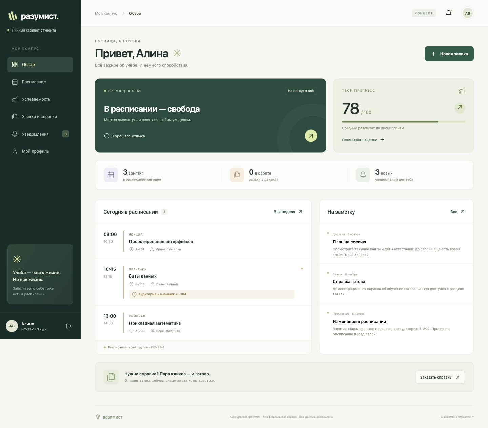
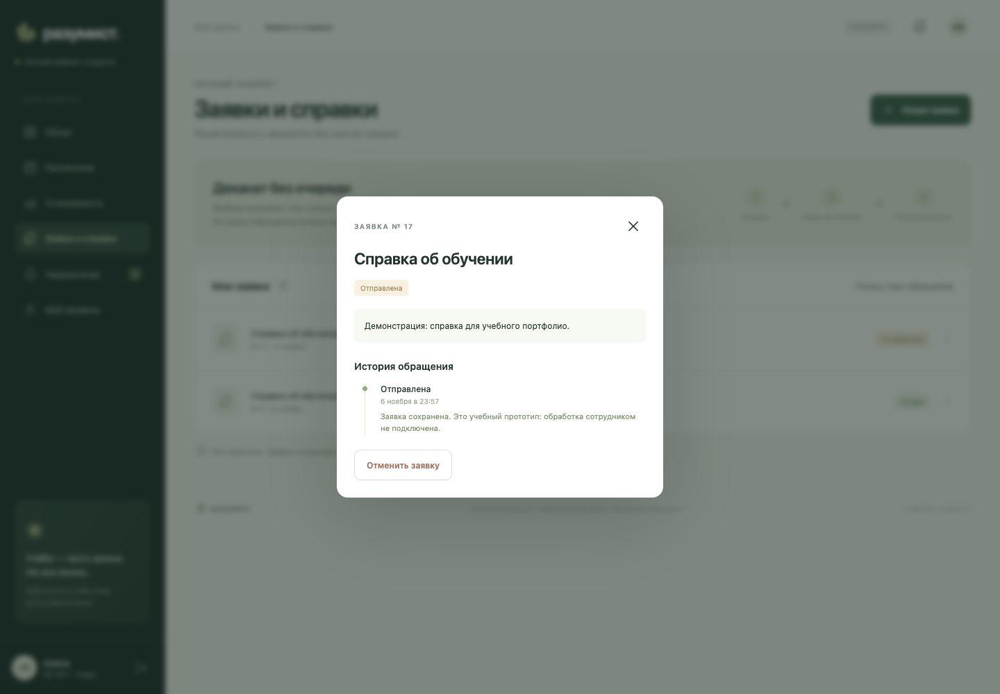
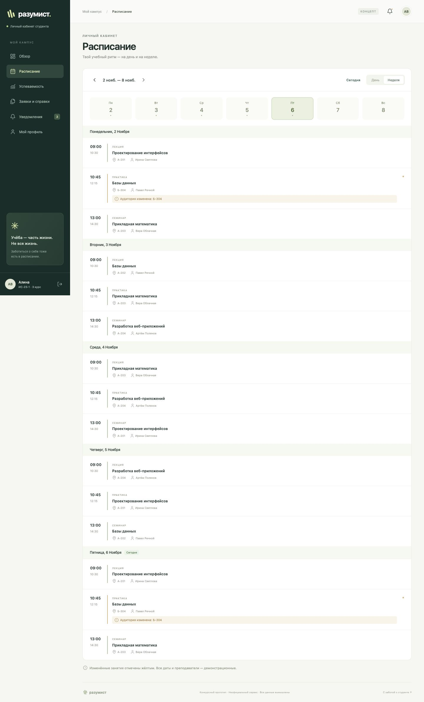
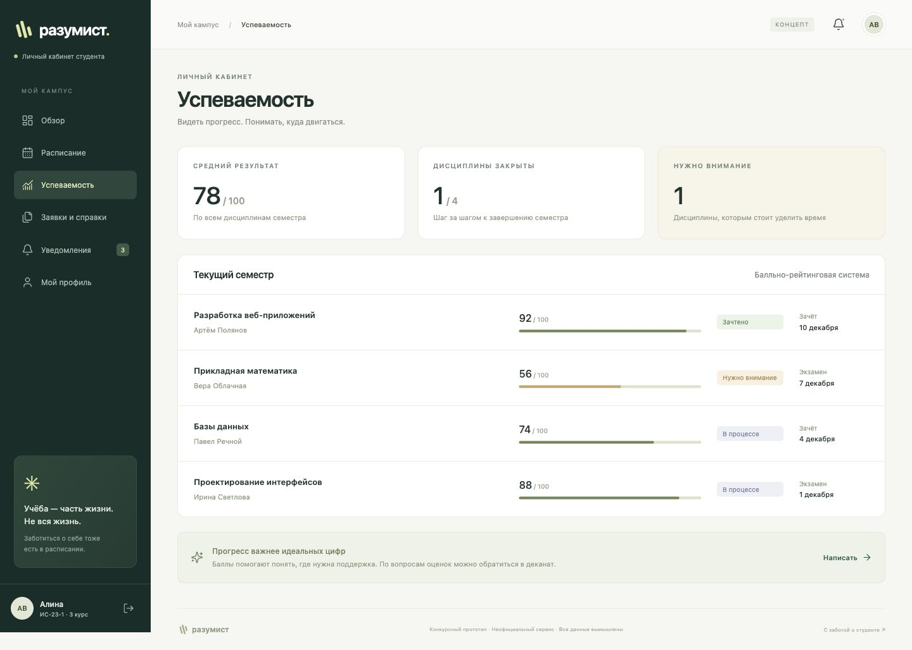
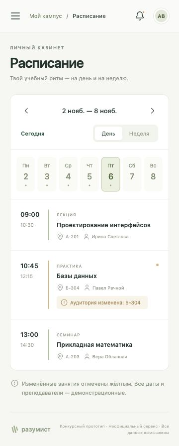
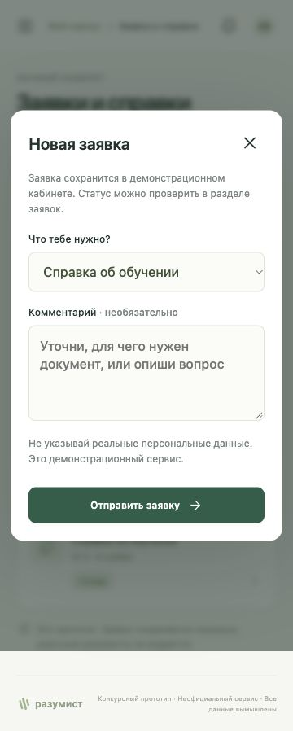
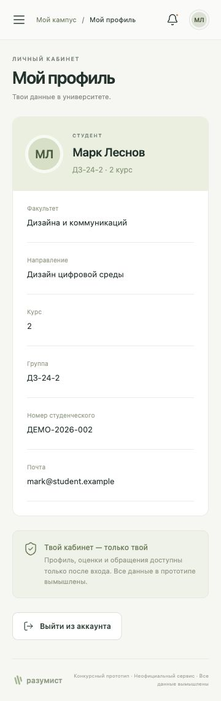
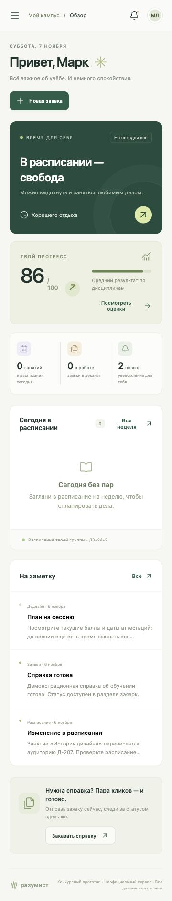

# «Разумист»: отчёт о создании прототипа

**Статус: рабочий черновик для последующего оформления конкурсной подачи.** Работа — 6–7 ноября 2026 года, МСК. Проект создаётся локально; пользователь прямо запретил деплой на этом этапе. Этот файл не заменяет итоговый PDF или документ со скриншотами.

## Проблема и продуктовая идея

Студенту приходится искать расписание, оценки, объявления и информацию о справках в разных местах. «Разумист» объединяет эти повседневные задачи в одном кабинете: открыть сегодняшний день, увидеть перенос занятия, оценить учебный прогресс и отправить обращение в деканат.

Пять обязательных разделов выбраны из ТЗ, а не из проведённого исследования. Опросы студентов в рамках этой работы пока не проводились. Главная страница связывает разделы через ближайшее занятие, учебную сводку, важные уведомления и быстрый заказ справки. Статус и история заявки снижают неопределённость: студент видит, что обращение зарегистрировано, и может отменить его.

Концепт использует вымышленный университет и вымышленные персональные данные. Это конкурсный прототип, не официальный сервис учебного заведения. Реальные логины, студенческие данные и системы вуза не используются. Официальный логотип вуза не используется.

## Процесс работы с ИИ

Пользователь передал ТЗ и назначил основного ассистента тимлидом. Тимлид прочитал требования, создал общий API-контракт и инструкции AGENTS.md, разделил работу между тремя субагентами: сервер, интерфейс, тесты и отчёт. Файлы поделены по зонам ответственности; интеграция остаётся у тимлида. Подробности — в DECOMPOSITION.md, фактические ключевые промпты — в PROMPTS.md.

Первое предложение стека — React + Node.js + SQLite. В локальном PATH не обнаружились node/npm; позже Go и Node были найдены вне PATH, поэтому первоначальный вывод об отсутствии установки был скорректирован; промежуточно началась версия Python + браузерный JavaScript. После уточнения пользователь выбрал **Go + React** и название **«Разумист»**. Команда переключила реализацию на этот стек, сохранив контракт и независимые HTTP-тесты. Это реальная итерация выбора технологии, которую важно показать в финальном отчёте.

## Использованные инструменты и материалы

| Инструмент / среда | Фактическое применение |
| --- | --- |
| Codex, настольное приложение | Основной ИИ-ассистент: анализ ТЗ, декомпозиция, код, тексты документации и интеграция |
| Субагенты Codex backend, frontend, qa_report | Параллельная разработка отдельных частей; это роли внутри одного инструмента, а не разные независимые ИИ-продукты |
| Навык Sites | Инструкции по локальной разработке и проверке сайта; публикация не запускалась |
| Локальный shell и файловые инструменты Codex | Чтение ТЗ, запись исходников, подготовка команд проверок |
| Go, React, SQLite | Выбранный пользователем технологический стек прототипа |
| Vite и pnpm | Сборка React-клиента и установка его зависимостей |
| lucide-react | Иконки интерфейса; сведения о сторонних лицензиях — в THIRD-PARTY.md |
| Python unittest и urllib | Внешние интеграционные HTTP-тесты; Python не является сервером окончательной версии |
| CUA, встроенный браузер Codex | Браузерная проверка desktop/mobile и сохранение скриншотов |
| Prettier 3.5.3 | Форматирование JSX, CSS и конфигурации |
| Git | Локальный каталог проекта; наличие публичного репозитория не заявляется |

Название точной модели, если оно требуется формой конкурса, нужно взять из подтверждённых настроек/экспорта чата: его нельзя достоверно определить по названию роли агента. На момент создания этого черновика не использовались сторонние изображения, генерация изображений, Figma, реальные системы вуза или внешние ИИ API. При добавлении инструментов этот перечень нужно обновить.

## Как устроены данные и защита

Реализован сервер Go с локальной SQLite. React показывает данные, полученные от сервера. В базе находятся вымышленные студенты, оценки, заявки, уведомления и сессии. Расписание сервер генерирует на текущую неделю, оно не хранится в базе. Два тестовых студента имеют разные данные. Публичные демо-пароли нужны только для этих вымышленных аккаунтов и не являются ключами реального сервиса.

При входе сервер проверяет пароль по стойкому хешу PBKDF2 с солью, затем выдаёт сессионную cookie с HttpOnly. Для дальнейших запросов он определяет студента по сессии. ID владельца не берётся из формы браузера. Доступ к чужой заявке или уведомлению отклоняется даже при ручной подстановке адреса. Для действий, меняющих данные, предусмотрены проверка Origin и CSRF-токен. Выход отзывает серверную сессию.

Заявки сохраняются в базе, а не только в состоянии браузера. Новая заявка получает статус регистрации; автоматическая «работа настоящего деканата» не имитируется. В начальных данных могут быть заранее подготовленные примеры других статусов для демонстрации.

API-поведение проверено внешними HTTP-тестами, включая изоляцию данных и сохранение после перезапуска. Это не заменяет аудит безопасности или нагрузочное тестирование. Развёртывание в интернете потребует отдельной настройки HTTPS и эксплуатационной среды; на текущем этапе оно не выполняется.

## Проверки и подтверждения

Подготовлен набор внешних HTTP-тестов tests/test_api.py: вход и ошибка пароля, обязательность авторизации, разные профили и учебные данные, cookie, создание и отмена заявки, защита от подмены владельца, IDOR на заявках и уведомлениях, CSRF и Origin, валидация, отзыв сессии после выхода и сохранение заявки после перезапуска.

**Подтверждено: 12 HTTP-тестов прошли, итог `OK`, время последнего запуска 3,130 с.** Команда: `RAZUMIST_SERVER_BIN=/tmp/razumist-server python3 -m unittest discover -s tests -v`. Сервер собран из Go-кода; используется временная SQLite, после проверки она удаляется. Дополнительно проверены точный лимит 10 неверных входов (11-й возвращает 429) и ротация сессии при повторном входе: старая cookie отзывается, новая работает.

Первый запуск был остановлен ограничением sandbox на локальный bind; после разрешённого запуска временного сервера тесты заработали. Следующий запуск выявил взаимодействие общего счётчика попыток входа с множественными успешными логинами в тестах. Тестовые сценарии изолированы отдельными процессами; серверный агент изменил limiter так, чтобы успешный вход сбрасывал счётчик своей пары IP/логин. Повторная проверка прошла. Тимлид также обнаружил блокировку входа при ревью серверного кода; backend исправил её до интеграции. Эти факты показывают проверку и исправление ИИ-кода, а не только его генерацию.

Браузерная проверка и клиентская сборка завершены; результаты и снимки приведены ниже. Подробный перечень приёмки находится в ACCEPTANCE.md.

## Иллюстрации для итогового документа

| Иллюстрация | Что подтверждает | Текущий статус |
| --- | --- | --- |
| Исходное ТЗ и первое распределение ролей в чате | Постановка задачи ИИ и организация работы | Снимок нужно сохранить |
| Уточнение Go + React и названия | Реальная обратная связь и смена решения | Снимок нужно сохранить |
| Главная на широком экране | Объединение повседневных задач | Снимки сохранены, см. ниже |
| Расписание с заметным переносом | Работа обязательного раздела | Снимки сохранены, см. ниже |
| Форма и созданная заявка с историей | Сквозной сценарий и сохранение | Снимки сохранены, см. ниже |
| Два профиля и отказ доступа к чужой заявке | Разделение персональных данных | Два входа проверены; IDOR подтверждён API-тестами |
| Главная и заявка на ширине 360 px | Мобильный сценарий | Проверено, снимки сохранены |
| Вывод сборки и тестов | Воспроизводимая техническая проверка | Результаты зафиксированы текстом; снимок терминала не сделан |

Промежуточные изображения нельзя создавать задним числом и выдавать за ранние макеты. Если неудачных визуальных вариантов не было, это нужно так и указать. Смена стека — подтверждённая итерация, но не доказательство визуального тестирования.

## Вклад человека

Подтверждённые ручные действия пользователя: выбор конкурсного задания, передача ТЗ, постановка роли тимлида и запрет деплоя, уточнение стека Go + React и названия «Разумист». Код, первоначальный дизайн и текущие тексты создаются ИИ-ассистентами. Ручное программирование, опросы однокурсников и ручное тестирование пользователем пока не заявляются.

Предстоит капитану команды: проверить итоговый продукт, при необходимости дать обратную связь, утвердить материалы, позже решить вопрос размещения и отправить работу. Эти действия пока являются планом.

## Что осталось для конкурсной подачи

Локальная интеграция завершена. Осталось оформить финальный PDF или документ и подготовить доступный жюри исходный код. Размещение с доступом из России без VPN и работой до 28 ноября, ссылка на прототип и отправка в конкурсный кабинет пока не выполнялись по указанию пользователя. По ТЗ приём работ начинается 8 ноября в 19:00 МСК. Условия конкурса здесь пересказаны из предоставленного ТЗ, без внешней проверки.

Проверенные демо-аккаунты: `alina` и `mark`, пароль для каждого — `Campus2026!`. Оба входа проверены в браузере. Видео до пяти минут опционально; сценарий вынесен в DEMO-SCRIPT.md.

## Итог локальной интеграции и браузерная проверка

Сборка React через Vite прошла: 1573 модуля, JavaScript 236,72 КБ (gzip 72,17 КБ), CSS 31,24 КБ (gzip 7,55 КБ). Go-сервер собран; `go vet ./...` прошёл. Итоговый стек — Go + React + SQLite.

Встроенный Node приложения не смог загрузить нативный Rollup из-за ограничений подписи macOS. Для сборки использован официальный Node.js 22.16.0, скачанный с nodejs.org в временный каталог. Конфликт расположения кэша pnpm устранён повторной установкой в единый кэш. Prettier 3.5.3 использован для форматирования исходников. Это реальные технические затруднения, а не неудачные макеты.

Через встроенный браузер Codex (CUA) проверены: вход Алины, создание заявки №17, её история, сохранение после обновления и отмена; расписание и оценки; мобильная подача обращения на ширине 360 px; ручной вход Марка; другой профиль и отсутствие заявок Алины; прочтение уведомления и сохранение отметки после обновления. На проверенных экранах ширина документа 360 px совпала с шириной окна, горизонтального переполнения нет. В журнале браузера ошибок и предупреждений JavaScript не обнаружено. Escape закрывает диалог. Скрытая мобильная панель исключена из доступной навигации через visibility.

Проверка проводилась в браузерном viewport 1440×1000 и 360×800, не на физическом телефоне. Полный аудит доступности и нагрузочное тестирование не проводились. Переход даты через полночь показал пустое расписание выходного дня; скриншоты поэтому могут относиться к 6 и 7 ноября. Заявки браузерной проверки оставлены как демонстрационные записи в локальной БД.

### Сохранённые реальные снимки

Снимки первоначального чата и исходного ТЗ не сохранялись; их можно добавить при оформлении подачи. Промежуточный визуальный макет отдельно не создавался — интерфейс разрабатывался сразу в React.

Итоговый `scripts/dev.sh` также проверен: он собрал React и Go, запустил локальный сервер на тестовом порту 8001; главная вернула HTTP 200. Проверочные серверы остановлены после приёмки. Для повторного запуска — команда из README.
