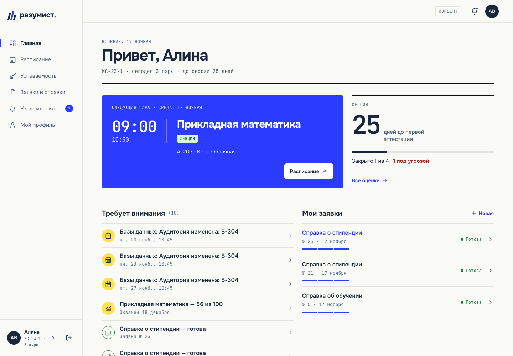
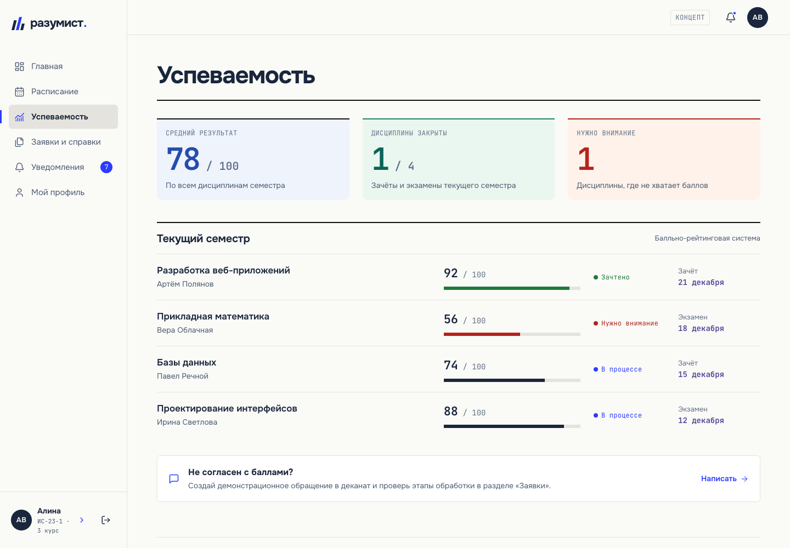
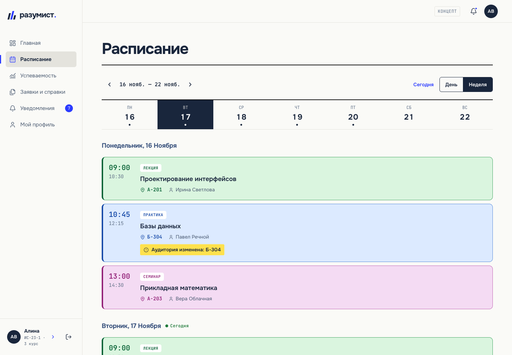
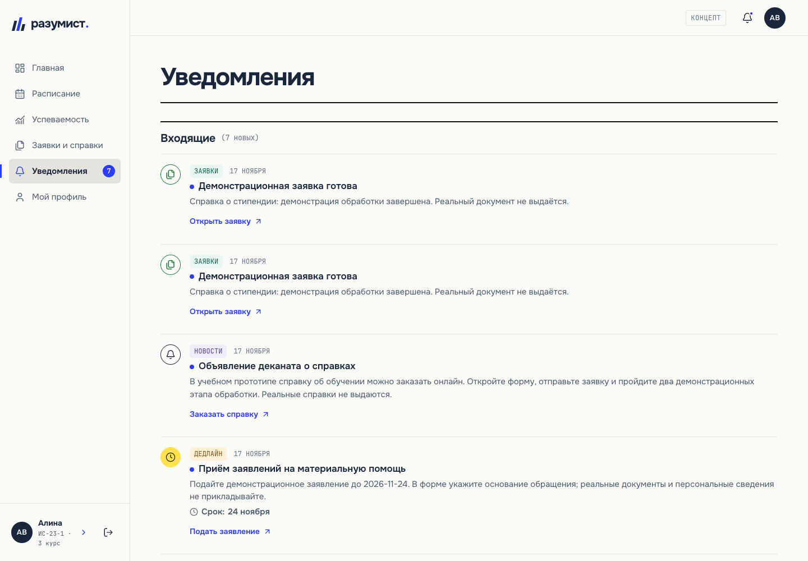
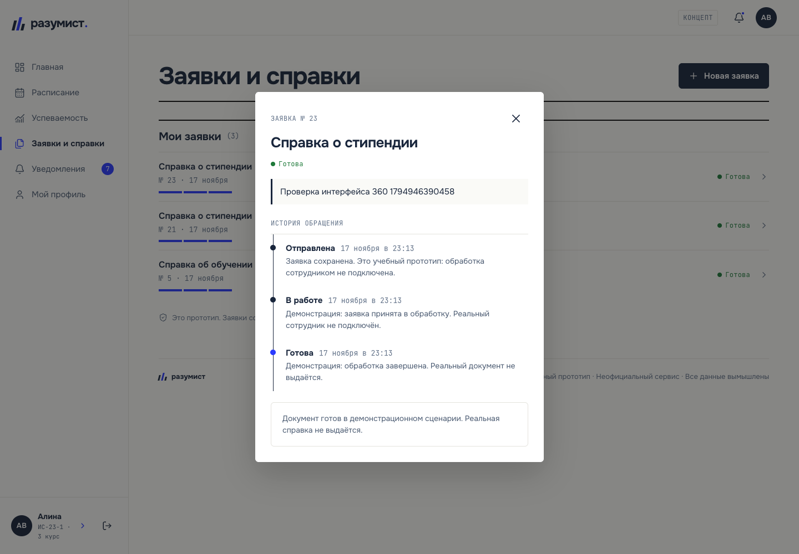
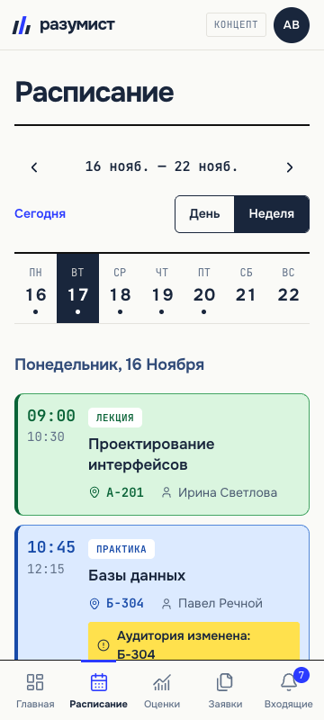
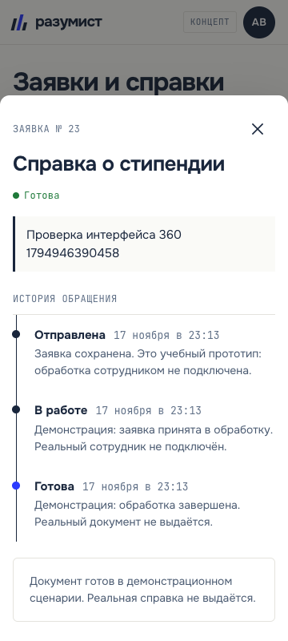

# Отчёт о создании
проекта Разумист

Личный кабинет студента на Go и React

Разработка 6–7 ноября 2026 года
Исправления и повторная проверка 17 ноября 2026 года

Разумист объединяет расписание, успеваемость, заявки и объявления в одном кабинете. В локальном прототипе можно войти под двумя вымышленными студентами, увидеть разные учебные данные, подать обращение и проверить его статус.

Документ показывает, как проект создавался с ИИ-ассистентами: от постановки задачи и распределения ролей до работающего интерфейса и проверок безопасности. Публикация в интернете на этом этапе не выполнялась.

Рисунок 1. Актуальная главная страница: учебная сводка и блок «Что требует внимания». Снимок от 17 ноября 2026 года.

## Проблема студентов и разделы кабинета

Учебная информация часто распределена между сайтом, отдельной системой оценок, чатами и деканатом. Студент тратит время на поиск нужного канала и не всегда понимает, изменилось ли расписание и что происходит с его заявкой.

Разделы выбраны по обязательным сценариям ТЗ. Опрос однокурсников не проводился; гипотезы о пользе сервиса ещё предстоит проверить с реальными пользователями.

| Раздел | Задача студента |
| --- | --- |
| Вход и профиль | Войти в свой кабинет и увидеть факультет, направление, курс и группу. |
| Расписание | Посмотреть занятия дня и недели, аудиторию, преподавателя и переносы. |
| Успеваемость | Сопоставить баллы, зачёты и даты сессии; заметить дисциплины, требующие внимания. |
| Заявки и справки | Отправить обращение, просмотреть историю и статус, отменить заявку. |
| Уведомления | Узнать об изменениях, объявлениях, точных сроках и готовности демонстрационной заявки. |

Рисунок 2. Успеваемость: средний результат, закрытые дисциплины, текущие баллы и даты аттестаций.

## Расписание выбранной недели

Расписание открывает выбранный день или неделю. При переходе на другую неделю интерфейс запрашивает её у сервера; даты рассчитываются для Москвы. Занятия показывают время, аудиторию, преподавателя и заметное изменение. Лекции выделены зелёным, практики синим, семинары насыщенным фиолетовым; текстовые названия сохраняются. Обзор использует текущую и следующую недели, чтобы не терять ближайшее занятие на выходных.

Рисунок 3. Расписание выбранной недели после исправления навигации. Снимок от 17 ноября 2026 года.

Раньше переключение даты не меняло серверную выборку: за пределами текущей недели пользователь видел пустой экран. Теперь дата недели передаётся в API, сервер нормализует её до понедельника и возвращает соответствующие занятия.

## Объявления и конкретные сроки

В уведомлениях есть объявления и дедлайны с точными датами. Действие из уведомления ведёт к нужному разделу или форме; важные события собраны также на главной. Данные являются демонстрационными и не отражают расписание реального вуза.

Рисунок 4. Уведомления в актуальном интерфейсе: объявления, сроки и переходы к действиям. Снимок от 17 ноября 2026 года.

Отметка прочтения сохраняется на сервере отдельно для каждого студента. Добавление новых демонстрационных событий не должно сбрасывать уже существующие отметки или пользовательские заявки.

## Сценарий обращения в деканат

Основной сквозной сценарий — от заказа справки до проверки сохранённой заявки. Интерфейс обращается к серверу Go, а запись хранится в SQLite и остаётся доступной после обновления страницы.

### Выбор услуги

Студент открывает форму и выбирает справку об обучении, справку о стипендии, материальную помощь или обращение в деканат.

### Отправка

Можно добавить комментарий. Сервер проверяет вход, CSRF-токен, тип обращения и допустимую длину текста.

### Демонстрация обработки

Новая запись получает статус «Отправлена». В карточке есть номер, комментарий, история и отмена. Явно помеченное демо-действие последовательно переводит её в обработку и готовность.

Рисунок 5. Заявка после демонстрации обработки: статус и сохранённая история переходов.

Реальная обработка сотрудником не подключена. Статусы меняются только по явному демо-действию владельца, а не автоматически по таймеру. При готовности появляется уведомление. Настоящая справка не выдаётся.

## Работа кабинета на телефоне

На узком экране разделы доступны через нижнюю панель навигации, карточки перестраиваются. Снимки ниже показывают актуальный интерфейс при ширине 360 px; результаты повторного прогона приведены в разделе проверок.

Рисунки 6 и 7. Расписание и заявка в актуальном интерфейсе при ширине 360 px. Снимки от 17 ноября 2026 года.

Для диалогов добавлены подписи полей, закрытие по Escape, удержание и возврат фокуса. Проверка на физическом телефоне и полный аудит доступности не проводились.

## ИИ инструменты и распределение работы

Основным ИИ-инструментом был Codex. Один ассистент работал как тимлид, три субагента выполняли ограниченные задачи в общем каталоге. Это роли внутри Codex, а не четыре разных ИИ-сервиса.

| Инструмент | Как использован |
| --- | --- |
| Codex | Анализ ТЗ, архитектура, код, тексты интерфейса, документация и интеграция. |
| Субагенты Codex | Первый цикл: backend, frontend, qa_report. Исправления: fix_backend, fix_frontend, update_report. Тимлид интегрирует и проверяет результат. |
| Навык Sites | Локальная разработка и проверка веб-проекта. Размещение не запускалось. |
| CUA, Playwright и Chrome | CUA — первоначальная проверка 6–7 ноября. Playwright и Chrome 157 — повторные desktop/mobile сценарии, ошибки и скриншоты 17 ноября. |
| Shell и Git | Работа с файлами, запуск сборок и тестов, локальный репозиторий. |
| Go и SQLite | HTTP API, сессии, контроль доступа и сохранение данных. |
| React и Vite | Интерфейс и клиентская сборка; Node.js, pnpm и npm — окружение и зависимости. |
| Python unittest и urllib | Интеграционные тесты настоящего HTTP API с временной базой. |
| Lucide, Onest, JetBrains Mono | Иконки и локальные шрифты. Лицензии ISC и SIL OFL 1.1 сохранены; обращения к шрифтовым CDN не нужны. |
| Prettier | Приведение исходников интерфейса к читаемому формату. |
| Навык Documents и python-docx | Подготовка этого документа; LibreOffice и PNG-рендер — проверка его оформления. |

### Как агенты согласовывали результат

Тимлид зафиксировал правила в AGENTS.md, маршруты и форматы данных в docs/API.md. Backend отвечал за main.go и зависимости Go, frontend — за src и клиентскую конфигурацию, QA — за tests и отчёт. Такой раздел файлов позволил работать параллельно и затем собрать единый проект.

ИИ использовался и для дизайна: визуальное направление было задано текстовым промптом и реализовано кодом. Генерация изображений, Figma, внешние ИИ API и официальные логотипы вузов в этом этапе не применялись.

## Этапы от идеи до работающего кабинета

### 1 Постановка задачи

Пользователь передал конкурсное ТЗ, поручил ассистенту роль тимлида, попросил распределить задачи субагентам, начать отчёт и не выполнять деплой. Приоритетом стали пять обязательных разделов, два аккаунта и мобильная версия.

### 2 Уточнение продукта и стека

Первое предложение — React, Node.js и SQLite. Из-за отсутствия Node в PATH началась промежуточная версия на Python. После уточнения пользователя окончательно выбраны Go + React и название «Разумист». Позже Go и Node нашлись вне PATH; Python-сервер был удалён.

### 3 Контракт и параллельная разработка

Созданы общие инструкции, API-контракт и критерии приёмки. Серверный агент реализовал вход и данные, интерфейсный — экраны и адаптивность, QA-агент — внешние HTTP-проверки и описание процесса.

### 4 Интерфейс сразу в коде

Отдельный макет в графическом редакторе не создавался. Первый вариант получил собственный знак и тёмно-зелёную навигацию. В текущей версии — светлый фон, тёмно-синяя типографика, цветовые акценты по смыслу и локальные шрифты Onest и JetBrains Mono. Предусмотрены загрузка, ошибки и пустые списки. По просьбе пользователя имя внизу боковой панели открывает профиль; цвет помогает различать виды занятий и сводки.

### 5 Интеграция и исправление ошибок

При ревью исправлена потенциальная блокировка повторного входа. Тесты выявили взаимодействие лимита входов с успешными авторизациями: сценарии изолировали, а счётчик стал сбрасываться после успешного входа для пары IP и логина. Добавлены проверки ротации сессии и лимита.

### 6 Сборка и браузерная приёмка

Конфликт кэшей pnpm потребовал повторной установки пакетов. Встроенный Node не загрузил Rollup из-за подписи macOS; сборка прошла с официальным Node.js. Затем проверены оба аккаунта, создание и отмена заявок, сохранение данных, уведомления и мобильные экраны.

В истории сохранены реальные технические итерации. Неудачные визуальные макеты не создавались и не реконструировались задним числом. Скриншоты в документе показывают проверенный интерфейс, а не эскизы.

## Ключевые промпты и решения

Ниже приведены фрагменты фактических сообщений. Многоточие обозначает сокращение. Более подробный журнал находится в docs/PROMPTS.md.

### Пользователь задаёт роль и границы

«ты в роли тим лида декомпозируй это тз для своих суб агентов, чтобы выполнить его и сделать отчет пока никуда не деплой, просто сделай рабочий проект, начни делать отчет»

Результат — распределение задач, локальная разработка и документация без публикации.

### Пользователь уточняет технологию

«стек golang + react, название: разумист»

Результат — смена промежуточной реализации и сохранение согласованного API.

### Тимлид задаёт требования серверному агенту

«Реальный cookie auth PBKDF2, CSRF, ownership, безопасная раздача static, rate limit login, logout, persistent db … Два демо аккаунта, разные данные, заявки создание/отмена/история (не симулируй реальную обработку автоматически).»

Требования сохранены при переходе на Go: данные привязаны к сессии, заявки не получают фиктивную автоматическую обработку.

### Тимлид задаёт сценарии интерфейса

«Вход два демо аккаунта, главная с ближайшей парой/сводкой/уведомлениями/быстрыми действиями; расписание день/неделя с датами и изменениями, оценки с прогрессом и сессией, заявки форма+история+отмена+статусы … Мобильный 360 px полноценный, accessible labels, error/loading/empty»

Результат — связанный набор экранов и адаптивная версия с состояниями ошибок и загрузки.

### Тимлид поручает тестирование и отчёт

«meaningful тесты входа, двух аккаунтов, изоляции заявок, CSRF, logout, сохранения данных, ошибок … Отчёт русский честный черновик с фактическими промптами/распределением ролей, критериями и планом скриншотов, без выдумки завершённых проверок»

На ревью дополнительно потребованы русские категории уведомлений, честный текст о демонстрационных заявках, клавиатурная работа диалогов и сброс окон при смене аккаунта. Прогресс-бары заменены на native progress, совместимый со строгой CSP.

## Вход хранение и защита данных

React отвечает за отображение, а Go принимает решения о доступе. Браузер отправляет логин и пароль; сервер сверяет пароль с хешем и создаёт сессию. Затем каждый запрос получает данные студента, определённого сервером по этой сессии.

| Механизм | Как он работает в прототипе |
| --- | --- |
| Пароли | В SQLite хранится хеш пароля PBKDF2-SHA256 с индивидуальной солью и 600 000 итераций. Открытый пароль в базе не хранится. |
| Сессия | Случайная cookie с HttpOnly и SameSite=Lax. На сервере хранится хеш токена; срок — 8 часов. Повторный вход заменяет старую сессию, выход отзывает её. |
| Чужие записи | SQL-запросы выбирают записи по ID и владельцу из сессии. Подстановка чужого ID возвращает 404; присвоить заявку другому студенту через форму нельзя. |
| Изменение данных | Для изменений после входа проверяются CSRF-токен и источник запроса. Есть ограничение размера JSON и длины комментария, проверка типа заявки. |
| Попытки входа | После 10 неверных попыток за минуту для пары IP и логина следующая отклоняется с 429. Успешный вход сбрасывает соответствующий счётчик. |
| Сохранение | SQLite хранит профили, оценки, заявки, уведомления и сессии. Расписание генерируется для выбранной недели по московской дате; обзор включает текущую и следующую недели. |
| Дополнительная защита | Настроены CSP и защитные HTTP-заголовки, проверка Host для loopback и ограничение раздачи файлов каталогом интерфейса. |

### Что подтвердили проверки 6–7 ноября

12 HTTP-тестов прошли успешно. Проверены обязательность входа, разные данные двух студентов, создание и отмена заявки, отказ в доступе к чужим записям, CSRF и Origin, валидация, выход, ротация сессии, лимит попыток и сохранение после перезапуска. Сборки Go и React и go vet также прошли.

Браузерная проверка подтвердила вход Алины и Марка, сохранение заявки после обновления, отмену, расписание, оценки и сохранение прочтения уведомления. Мобильное обращение отправлено на ширине 360 px. Эти результаты относятся к первоначальной приёмке 6–7 ноября; повторный прогон описан отдельно.

Локальная версия работает по HTTP. Для будущего HTTPS через обратный прокси добавлена явная настройка public-origin: она задаёт допустимый Origin и безопасную cookie. Произвольные Forwarded-заголовки не считаются доверенными. Публичное размещение не выполнялось. Демо-пароли публичны и предназначены только для вымышленных данных. Нагрузочное тестирование и независимый аудит безопасности не проводились.

## Исправления после оценки по требованиям

17 ноября пользователь поручил тимлиду разложить найденные проблемы на задачи субагентам, исправить их и повторно оценить проект. Ограничения сохранены: без деплоя и без новых коммитов.

| Проблема | Изменение |
| --- | --- |
| Недели расписания | Сервер принимает выбранную неделю; интерфейс запрашивает её при переключении и показывает состояния загрузки и ошибки. |
| Дедлайны без конкретики | Добавлены объявления и уведомления с точной датой и действием; они связаны с блоком внимания на главной. |
| Незавершённая демонстрация заявки | Владелец явно запускает демо-переходы «Отправлена → В работе → Готова». История сохраняется; появляется уведомление. |
| HTTPS за обратным прокси | Явный public-origin определяет разрешённый источник и Secure cookie; заголовки клиента не меняют доверенный адрес. |
| Устаревший отчёт | Скриншоты заменены актуальными, описаны локальные шрифты, добавлены новые промпты и результаты проверок. |

### Промпт пользователя на повторный цикл

«пока деплой не делаем, в агентском режиме декомпозируй задачи в качестве тимлида субагентам по исправлению ошибок, потом проведи повторную оценку и распиши результаты изменений, в коде не делай коммитов просто оставь изменения, отчет обновляй»

### Промпты тимлида на исправления

«GET schedule поддержка week=YYYY-MM-DD нормализовать понедельник MSK, валидация … миграция seed для существующих демо DB без сброса пользовательских записей.»

«Реализуй рабочее переключение недель с loading/errors/race handling, время MSK и обновление дня, attention с конкретными дедлайнами/переходами.»

Это фрагменты фактических задач текущего цикла. Контракт согласован между агентами до интеграции; серверные и интерфейсные изменения разделены по файлам.

## Повторная проверка и оценка

### Сервер и сборка

17 ноября повторно прошли 16 HTTP-тестов за 9,963 с и production-сборка React через Vite. Новые тесты проверяют выбранную неделю, переходы заявки и уведомление, сохранность отметок при миграции, Secure cookie и public-origin. Сохранены проверки входа, изоляции двух аккаунтов, CSRF, лимита, ротации сессии и сохранения после перезапуска.

### Браузерные сценарии

Playwright и Chrome 157: успешный прогон на 1440×1000 и 360×800. Проверены вход, следующая неделя, оценки, создание заявки и переходы до готовности, сохранение после обновления, уведомления со сроком, профиль, Escape и отказ 404 второму аккаунту на чужую заявку. Ошибок JavaScript и горизонтального переполнения нет. Браузер работал в America/Los_Angeles, интерфейс показывал московские даты.

### Ошибки и клавиатура

Отдельно прошли быстрое переключение недель с задержками ответов 700/80 мс, ошибка расписания 500 и повторная загрузка, предзаполнение материальной помощи из дедлайна, цикл фокуса Tab/Shift+Tab и закрытие Escape. Проверки использовали временную базу.

### Оценка по четырём критериям

| Критерий | Оценка | Основание |
| --- | --- | --- |
| Идея | 8/10 | Пять разделов связаны через блок внимания, сроки и действия. Гипотезы ещё не проверены на студентах. |
| Использование ИИ | 8/10 | Роли, реальные промпты, ошибки и исправления зафиксированы в документации. |
| Имплементация | 8/10 | Работают недели и демо-заявки, проходят 16 API-тестов и браузерные сценарии. Публичный доступ не проверен. |
| Качество | 8/10 | Проверены 360 px, ошибки, повторная загрузка и клавиатура диалогов. Полного аудита доступности нет. |

Итого 32 из 40 баллов. Оценка предварительная, выполнена ассистентом по предоставленному ТЗ; она не является решением жюри. Наличие локальных ресурсов не доказывает доступность будущего размещения из России.

### Ограничения

Опросы студентов, проверка на физическом телефоне, нагрузочное тестирование и независимый аудит безопасности не проводились. Публичная ссылка, доступность до 28 ноября и отправка работы на конкурс остаются отдельным этапом по решению пользователя.

## Ручные этапы и итог проекта

### Что сделал человек

Пользователь выбрал конкурсное задание и передал ТЗ ассистенту. Он определил способ работы: ассистент в роли тимлида, декомпозиция на субагентов, уточнения по реализации и подготовка отчёта. Отдельно задал запрет на деплой.

Ключевое продуктовое решение человека — стек Go + React и название «Разумист». После уточнения эти требования заменили промежуточные решения ассистента. Позже пользователь указал перенести проект в «Загрузки/hackaton», запросил документ со скриншотами и поручил повторную оценку с исправлениями без коммитов и деплоя.

Сам перенос файлов, написание кода, создание исходного дизайна, запуск проверок и подготовка текста выполнялись ассистентами. Ручное программирование, опрос однокурсников или самостоятельное тестирование пользователем в описанном этапе не заявляются. Ввод логина Марка во время браузерной проверки также выполнял ассистент.

### Что получилось

Создан локальный прототип со всеми пятью обязательными разделами, обзором дня и профилем. Есть два независимых аккаунта, сохраняемые заявки, история и отмена обращений, отметки прочтения уведомлений и мобильная компоновка. Все студенты, преподаватели и учебные сведения вымышлены; интерфейс помечен как конкурсный концепт.

### Как воспроизвести демонстрацию

В папке проекта выполнить ./scripts/dev.sh и открыть http://127.0.0.1:8000. Проверить расписание и оценки, создать заявку, обновить страницу, затем сменить аккаунт и убедиться в разделении данных. Подробные команды и требования к окружению находятся в README.md.

| Студент | Логин | Демо пароль |
| --- | --- | --- |
| Алина Ветрова | alina | Campus2026! |
| Марк Леснов | mark | Campus2026! |

### Материалы проекта

Исходное ТЗ сохранено в docs/BRIEF.txt; распределение задач — в docs/DECOMPOSITION.md; ключевые запросы — в docs/PROMPTS.md; контракт — в docs/API.md; проверки — в tests/test_api.py; лицензии — в docs/THIRD-PARTY.md и docs/licenses. Оригиналы снимков находятся в screenshots.

### Следующий этап

Капитану команды остаётся оценить продукт и документ, при необходимости дополнить сведения о последующей работе, отдельно решить вопрос хостинга и отправки. Деплой, подключение к реальным системам вуза и выдача настоящих документов в описанный этап не входят.
